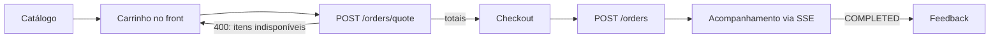
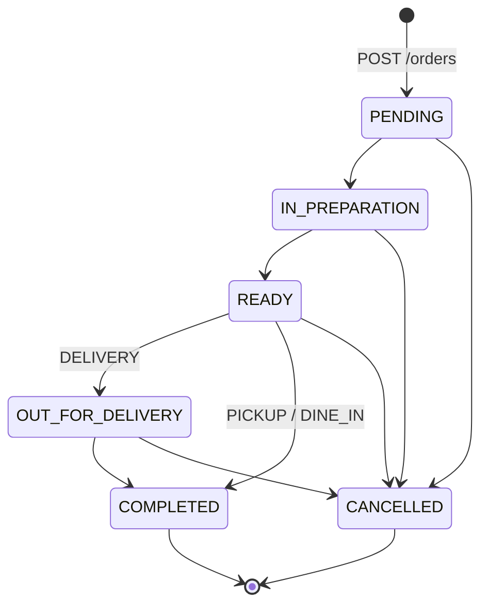

> **Status:** implementação em andamento, pelas fases da seção [[#Roadmap de implementação|Roadmap]]. Já existem a cotação, a criação, a consulta, o histórico do cliente, a listagem do dashboard, a mudança de status, o pagamento, o cancelamento e a edição de itens. SSE e feedback ainda não existem no código.

Um *Order* (pedido) é a compra que um cliente faz na Marusan: os produtos e combos escolhidos, como ele quer receber, como vai pagar e em que etapa o pedido está. Ele cobre os requisitos de escopo 1, 2, 5–7, 9, 13 e 14 e os requisitos 40–46, 48–51, 52 (parcial), 53 e 54 de [`requirements.md`](requirements.md).

Diagramas (draw.io):

- Fluxo do pedido: [`diagrams/orders-flow.drawio`](diagrams/orders-flow.drawio)
- Máquina de estados: [`diagrams/order-status.drawio`](diagrams/order-status.drawio)
- Modelo de dados: página *Orders* de [`data-modeling/data_modeling.drawio`](data-modeling/data_modeling.drawio)

## Fluxo



1. **Carrinho.** O carrinho vive no front (navegador ou app), não no banco. Assim ele funciona igual para cliente logado e visitante, e não sobram carrinhos abandonados para limpar.
2. **Cotação.** `POST /orders/quote` recebe os itens do carrinho e devolve cada item com preço unitário, preço original (quando há promoção), subtotal e total. Ele confere a disponibilidade e **não grava nada**. É assim que o front mostra o carrinho com o preço correto (req. 46).
3. **Checkout.** `POST /orders` recebe os mesmos itens, mais o tipo de atendimento, o endereço (se for entrega), a forma de pagamento e as observações. O pedido nasce em `PENDING`.
4. **Acompanhamento.** O cliente e o dashboard recebem as mudanças em tempo real (ver [[#Notificações (SSE)|Notificações]]).
5. **Feedback.** Depois de `COMPLETED`, o cliente pode avaliar o pedido (req. 48).

**O backend sempre recalcula os preços**, tanto na cotação quanto no checkout e na edição. O front nunca envia preço, e qualquer valor que ele mande é ignorado.

## Itens do pedido

Um pedido tem um ou mais itens, e cada item é de um de dois tipos:

### `PRODUCT`

O cliente informa:

- `productSizeId`: o produto já no tamanho escolhido (a combinação de `product_size`, onde mora o preço);
- `quantity` (≥ 1) e `notes` (observação do item, req. 44);
- `additionals`: lista de `{ingredientId, quantity}`. Cada adicional precisa estar configurado como *Additional Ingredient* `ACTIVE` daquele produto, e a quantidade não pode passar do `maximumQuantity` (req. 53). A quantidade é **por unidade do item** ("2 de queijo extra" em cada pastel), e o acréscimo por unidade é `ingredient.price × quantity`. O mesmo ingrediente não se repete na lista: a repetição é a quantidade;
- `removedIngredientIds`: lista de `ingredientId` da composição do produto (*Product Ingredient*) que o cliente quer tirar (req. 45). Remover não muda o preço.

**Total do item:** `(preço unitário + acréscimo dos adicionais) × quantity`, arredondado para 2 casas.

**Preço unitário:** o preço do `product_size`. Se existir uma promoção `ACTIVE` para o produto, dentro da janela de datas no horário do restaurante (`BusinessTime.now()`), o preço é o promocional, calculado pela mesma regra de *Promotion Type* que já existe (ver [[products-and-promotions#Promotions|products-and-promotions.md]]). A promoção é aplicada **automaticamente**: o cliente não escolhe a promoção, ele pede o produto. O item guarda o `promotion_id` e o preço original para referência.

### `COMBO`

O cliente informa `comboId`, `quantity` e `notes`. O combo tem **precificação própria**: o valor do item é `combo.price × quantity`. Os preços de tamanho e as promoções de produto não se aplicam dentro de um combo. A composição do combo (produto, tamanho quando houver, e quantidade de cada `combo_product`) é copiada para o item **sem preço**, só para a cozinha saber o que preparar.

### Disponibilidade

A cotação, o checkout e a edição recusam com `400` e listam **todos** os itens com problema de uma vez, para o front mostrar ao cliente o que ajustar (req. 54). A resposta usa o mesmo formato da falha de validação, com `message` = `Some items are unavailable` e uma entrada em `violations` por problema, cujo `field` aponta o item (`items[1]`, `items[1].additionals[0]`, `items[2].removedIngredientIds[0]`). Contam como problema:

- produto `INACTIVE`, combinação de tamanho `INACTIVE` ou combo `INACTIVE`;
- combo fora da janela de datas;
- adicional `INACTIVE` ou não configurado para o produto, ou acima do `maximumQuantity`;
- adicional `OUT_OF_STOCK`;
- ingrediente da composição `OUT_OF_STOCK`, **a menos que o cliente o tenha removido** do item: um pastel de palmito sem palmito pode ser vendido com o palmito esgotado;
- ingrediente removido que não faz parte da composição do produto, ou repetido na lista;
- item `PRODUCT` sem `productSizeId` (ou com `comboId`), e item `COMBO` sem `comboId` (ou com `productSizeId`, adicionais ou ingredientes removidos).

A propagação de "esgotado" entre ingrediente, produto e combo continua manual (ver [[products-and-promotions#Product|products-and-promotions.md]]). O pedido só respeita o status que cada item tem no momento.

Um id inexistente no corpo (`productSizeId`, `comboId`, `ingredientId`, `clientId`, `addressId`) é `404`, conforme a regra geral de [[architecture#Referências e exclusão|architecture.md]].

### Snapshot de preço e nome

Cada item, adicional, ingrediente removido e componente de combo grava uma **cópia** do nome, do tamanho e do preço unitário do momento da compra. Assim, o histórico do cliente (req. 14) e o dashboard de vendas continuam corretos se o produto mudar de preço ou for excluído depois.

Por isso, pedidos **não bloqueiam** a exclusão de produtos, tamanhos, combos, promoções ou ingredientes: as referências do pedido a esses agregados são opcionais e viram `null` (`on delete set null`). Essa é uma exceção consciente à regra de bloqueio de [[architecture#Referências e exclusão|architecture.md]], porque o pedido não depende do item existir para continuar fazendo sentido.

## Atendimento

`fulfillmentType`:

| Tipo | Uso | Endereço |
| --- | --- | --- |
| `DELIVERY` | Entrega | Obrigatório (escopo 13). O cliente logado escolhe um dos seus *User Address* (`addressId`); o visitante ou o funcionário informa o endereço no corpo. Nos dois casos ele é **copiado** para o pedido. |
| `PICKUP` | Retirada no balcão | Não se aplica |
| `DINE_IN` | Consumo no local (req. 9) | Não se aplica |

A taxa de entrega fica fora da v1: `delivery_fee` existe e vale `0`.

## Quem faz o pedido

| Quem | Como | Dados |
| --- | --- | --- |
| *Client User* logado | Token de cliente | Pedido ligado ao `client`. Na entrega, informa `addressId` de um endereço seu (`404` se for de outro cliente). Não envia `clientId`, `guestName`, `guestPhone` nem `address` (`400`). |
| *Guest User* (visitante) | Sem token (escopo 2) | `guestName` e `guestPhone` obrigatórios e, na entrega, `address`. Ficam gravados **no próprio pedido**, sem criar conta (ver [[user-management#Guest User|user-management.md]]). Não envia `clientId` nem `addressId` (`400`). |
| *Internal User* com `manage_orders` | Token interno | Lança o pedido no balcão (escopo 7). Em nome de um cliente: `clientId` (`404` se não existir) e, na entrega, `addressId` desse cliente ou `address`. Em nome de um visitante: só `guestName` é obrigatório (mesa, balcão), e na entrega vai `address`. O pedido guarda `created_by_internal_id`. |

Um *Internal User* sem `manage_orders` não cria pedidos: ele não é cliente (um `User` é cliente **ou** interno).

### Acompanhamento do visitante

A resposta de `POST /orders` é `{order, trackingToken}`. Todo pedido sem cliente (o do visitante e o que o funcionário lança para um visitante) recebe, uma única vez:

- `code`: código de 6 caracteres, sem os que se confundem lidos em voz alta (0/O, 1/I/L), mostrado ao cliente e usado no balcão;
- `trackingToken`: segredo aleatório que o front guarda e envia no header `X-Order-Token`.

O banco guarda só o SHA-256 do token, como no refresh token. O token dá acesso **àquele pedido** e a nada mais: consultar, acompanhar pelo SSE, cancelar (enquanto `PENDING`) e enviar o feedback. O cliente logado também recebe `code`, mas acessa o pedido pelo próprio token de acesso, e `trackingToken` vem nulo.

## Status



- O pedido nasce em `PENDING` (aguardando a cozinha). Os estados do dashboard (escopo 6: pendente, em preparo, finalizado) são `PENDING`, `IN_PREPARATION` e `COMPLETED`; `READY` e `OUT_FOR_DELIVERY` detalham o meio do caminho.
- Só o funcionário (`manage_orders`) avança o status, sempre um passo por vez, pelo caminho do diagrama. `OUT_FOR_DELIVERY` só existe para `DELIVERY`; `PICKUP` e `DINE_IN` vão de `READY` direto para `COMPLETED`. Uma transição fora do caminho é `400`.
- **Cancelamento** (req. 41):
  - o cliente ou o visitante cancela só em `PENDING`, ou seja, antes de a cozinha começar;
  - o funcionário cancela em qualquer estado antes de `COMPLETED`, informando o motivo (`cancelReason`).
- `COMPLETED` e `CANCELLED` são finais.
- `POST /orders/{id}/status` recebe `{status}` com o **próximo** estado; pular etapas ou pedir `CANCELLED` por ela é `400`.
- `POST /orders/{id}/cancel` aceita corpo opcional `{reason}` e não exige `Content-Type`. Só o motivo do funcionário é obrigatório.
- A listagem do dashboard, `GET /orders?status=`, devolve resumos do mais antigo para o mais novo (a fila da cozinha); sem `status`, traz todos.
- Toda mudança, incluindo a criação, grava uma linha em `order_status_history` (status, instante e quem mudou; `null` para o visitante).

"Pedidos ativos" (req. 42) são os que não estão em `COMPLETED` nem em `CANCELLED`.

### Pagamento

Na v1 não há gateway (req. 52 parcial). O pedido grava a forma de pagamento escolhida no checkout (`PIX`, `CARD` ou `CASH`), paga na entrega ou no balcão. O funcionário marca o pedido como pago (`POST /orders/{id}/pay`, sem corpo), o que preenche `paid` e `paid_at` e gera uma notificação (req. 49). Marcar de novo um pedido já pago, ou um pedido cancelado, é `400`. O pagamento é independente do status: um pedido pode ser pago antes ou depois de sair para a entrega.

A integração com um gateway (Pix dinâmico, cartão online) fica para uma fase 2, como um agregado `Payment` próprio. Nessa fase deve surgir um estado anterior a `PENDING` (aguardando pagamento).

### Edição pelo funcionário

O funcionário pode trocar os itens de um pedido em `PENDING` ou `IN_PREPARATION` (req. 43), com `PUT /orders/{id}/items`. A lista enviada substitui a anterior e passa pelas mesmas regras de disponibilidade e preço da criação, **com os preços do momento da edição**. O cliente não edita o pedido: se quiser mudar algo, cancela (enquanto `PENDING`) e faz outro.

### Feedback

Com o pedido em `COMPLETED`, o dono (cliente ou visitante com o token) pode enviar um feedback, `POST /orders/{id}/feedback`, com nota de 1 a 5 e comentário opcional. É um feedback por pedido; um segundo envio é `400`. O evento SSE de `COMPLETED` é o sinal para o front pedir a avaliação (req. 48).

## Notificações (SSE)

As mudanças chegam em tempo real por *Server-Sent Events* (req. 49–51):

| Rota | Quem | Recebe |
| --- | --- | --- |
| `GET /orders/{id}/events` | dono, token de acompanhamento ou `manage_orders` | Mudanças daquele pedido |
| `GET /orders/events` | `manage_orders` | Feed do dashboard: pedido novo, mudança de status, pagamento, cancelamento, edição |

Cada evento traz o tipo (`CREATED`, `STATUS_CHANGED`, `PAID`, `CANCELLED`, `ITEMS_UPDATED`), o id e o código do pedido, o status atual e o instante. Os eventos são publicados **só depois do commit**, para ninguém ser avisado de uma mudança que voltou atrás.

O SSE é só um aviso: o estado oficial é o pedido. Ao reconectar, o front busca `GET /orders/{id}` (ou a listagem, no dashboard) para recuperar o que perdeu. Os limites da implementação em memória estão em [[architecture#Autenticação: implantação e riscos conhecidos|architecture.md]], e o jeito de consumir o SSE com autenticação, em [`api-client.md`](api-client.md).

## Acesso à API

| Rota | Acesso |
| --- | --- |
| `POST /orders/quote` | pública |
| `POST /orders` | pública (visitante), cliente autenticado ou `manage_orders` |
| `GET /orders?status=` (paginado) | `manage_orders` |
| `GET /orders/events` | `manage_orders` |
| `GET /orders/{id}`, `GET /orders/{id}/events` | dono, token de acompanhamento ou `manage_orders` |
| `POST /orders/{id}/cancel` | dono ou token (só em `PENDING`), ou `manage_orders` |
| `POST /orders/{id}/feedback` | dono ou token |
| `POST /orders/{id}/status`, `POST /orders/{id}/pay`, `PUT /orders/{id}/items` | `manage_orders` |
| `GET /users/{id}/orders` (paginado, histórico) | o próprio usuário ou `manage_users` |

A regra "dono, token ou `manage_orders`" depende de dados, por isso fica no `OrderService`, via `CurrentUser` (mesmo padrão do `requireSelfOr`). Um pedido inexistente devolve `403` para quem não pode acessá-lo, sem revelar se ele existe; só quem tem `manage_orders` recebe `404`. Sem login e sem `X-Order-Token`, a resposta é `401`.

`GET /users/{id}/orders` devolve uma página de resumos (código, status, atendimento, pagamento, quantidade de itens, total e data), do mais recente para o mais antigo. Um usuário interno não tem pedidos próprios e recebe uma página vazia. O detalhe com itens e histórico de status fica em `GET /orders/{id}`. A permissão `manage_orders` está descrita em [[user-management#Permissions|user-management.md]].

## Modelo de dados

```
orders(id, code UNIQUE, client_id NULL, created_by_internal_id NULL, tracking_token_hash NULL,
       guest_name, guest_phone, fulfillment_type, status, payment_method, paid, paid_at,
       street_address, number, cep, complement, notes, cancel_reason,
       subtotal, discount, delivery_fee, total, created_at, updated_at)
order_item(id, order_id, item_type, product_size_id NULL, combo_id NULL, promotion_id NULL,
           name, size_name, quantity, original_unit_price, unit_price, notes)
order_item_additional(id, order_item_id, ingredient_id NULL, name, quantity, unit_price)
order_item_removed_ingredient(id, order_item_id, ingredient_id NULL, name)
order_item_combo_component(id, order_item_id, product_id NULL, product_size_id NULL, name, size_name NULL, quantity)
order_status_history(id, order_id, status, changed_at, changed_by_user_id NULL)
order_feedback(id, order_id UNIQUE, rating, comment, created_at)
```

- A tabela se chama `orders` porque `order` é palavra reservada no SQL.
- `created_at`, `updated_at`, `paid_at`, `changed_at` são instantes técnicos (`Instant` / `timestamptz`). A janela de promoção e de combo continua em horário de negócio (`BusinessTime`).
- Valores em `numeric(38, 2)`, como os preços do catálogo. `discount` fica reservado para cupons e pontos (fora da v1) e vale `0`.
- Os itens, adicionais, removidos, componentes, histórico e feedback são **filhos do agregado** `Order`: não têm endpoint próprio e só são lidos e gravados pelo pedido.
- As FKs para `client`, `internal`, `user`, `product`, `product_size`, `combo`, `promotion` e `ingredient` são `on delete set null` (ver [[#Snapshot de preço e nome|Snapshot]]).

## Fora da v1

- Cupons (req. 34–35) e pontos (escopo 8, req. 36–37): `discount` reservado.
- Taxa de entrega: `delivery_fee` reservado.
- Gateway de pagamento (req. 52 completo).

## Roadmap de implementação

Cada fase é uma branch própria, a partir de `main`:

1. ✅ `refactor/combo-product-size`: `combo_product` ganha o tamanho (`product_size_id`, obrigatório quando o produto tem tamanhos) e `quantity` (ver [[products-and-promotions#Combo Product|products-and-promotions.md]]).
2. ✅ `feat/order-quote`: modelos, cálculo de preço e `POST /orders/quote`.
3. ✅ `feat/order-checkout`: persistência, `POST /orders`, visitante e token de acompanhamento, `GET /orders/{id}`, histórico do usuário, permissão `MANAGE_ORDERS`.
4. ✅ `feat/order-lifecycle`: status, pagamento, cancelamento, edição de itens, `GET /orders` paginado.
5. `feat/order-events`: SSE do pedido e do dashboard.
6. `feat/order-feedback`.
