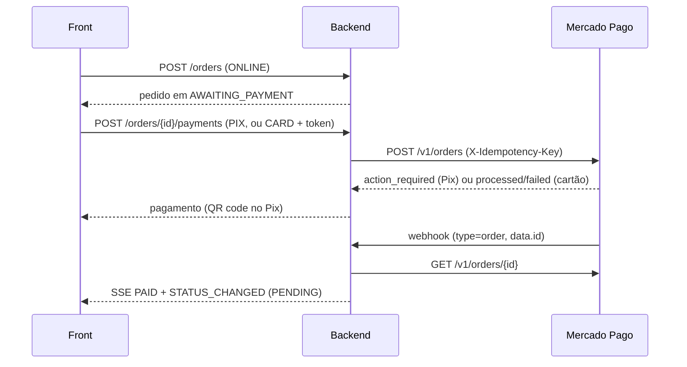
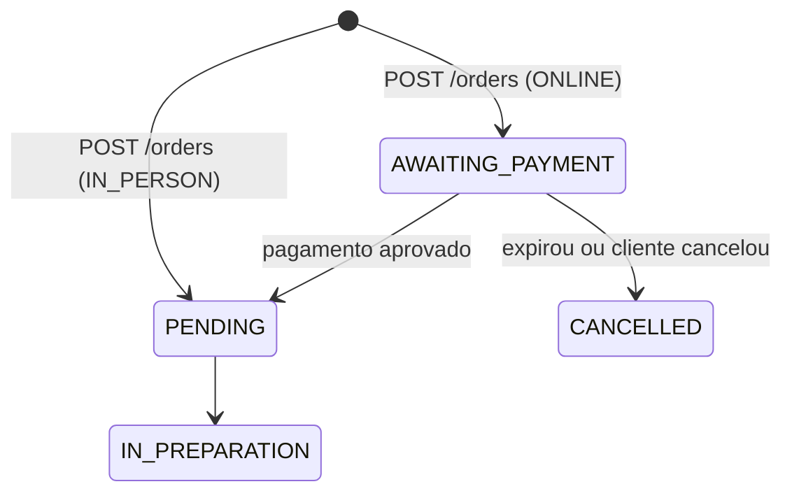

> **Status:** todas as fases do [[#Roadmap de implementação|Roadmap]] implementadas: Pix e cartão online, webhook, aprovação do pedido, reconciliação agendada, cancelamento com estorno e chargeback. Pix, cartão aprovado e estorno testados ponta a ponta no sandbox. As decisões de [[#Decisões|Decisões]] marcadas como *proposta adotada* valem até alguém decidir diferente.

Esta página descreve o pagamento online dos pedidos com o Mercado Pago, que completa o requisito 52 de [`requirements.md`](requirements.md) ("o cliente deve conseguir pagar pelo produto diretamente pelo sistema"). Na v1 dos pedidos o funcionário só marca o pedido como pago (ver [[orders#Pagamento|orders.md]]). Esse caminho continua existindo para quem paga na entrega ou no balcão.

## Visão geral

- **Provedor:** Mercado Pago, pelo Checkout Transparente com a **API Orders** (`/v1/orders`). O cliente paga dentro do front, sem ser redirecionado. A Payments API (`/v1/payments`) é a versão legada e não é usada.
- **Meios online:** Pix dinâmico (QR code e copia e cola) e cartão de crédito à vista.
- **O cartão nunca passa pelo backend.** O front usa o Card Payment Brick do Mercado Pago com a *public key*, que tokeniza o cartão. O backend recebe só o token, e o escopo PCI fica mínimo.
- **O valor sempre vem do pedido.** O backend cobra `orders.total`, recalculado por ele no checkout. O front nunca envia valor.
- **A fonte da verdade é o Mercado Pago.** O webhook só avisa que algo mudou. O backend busca a order na API do Mercado Pago antes de mudar qualquer estado.

Para não confundir os dois sentidos de "order": nesta página, **pedido** é o `Order` do nippon-ten, e **order do Mercado Pago** é o recurso `/v1/orders` da API deles. Cada `Payment` nosso corresponde a uma order do Mercado Pago.

## Fluxo



1. **Checkout.** `POST /orders` com `paymentChannel = ONLINE` cria o pedido em `AWAITING_PAYMENT`. A cozinha ainda não vê esse pedido na fila.
2. **Cobrança.** `POST /orders/{id}/payments` cria uma tentativa de pagamento. O pedido e a cobrança são chamadas separadas para permitir tentar de novo (cartão recusado, Pix expirado) sem refazer o pedido.
3. **Pix.** A resposta traz o `qrCode` (copia e cola), o `qrCodeBase64` (imagem) e o `expiresAt`. O pagamento fica `PENDING` até o webhook.
4. **Cartão.** A resposta já traz o resultado (`APPROVED`, `REJECTED` ou `PENDING` quando fica em processamento). O webhook confirma mudanças posteriores.
5. **Aprovação.** Com o pagamento `APPROVED`, o pedido fica `paid = true`, `paid_at` preenchido e passa de `AWAITING_PAYMENT` para `PENDING`. Saem os eventos SSE `PAID` e `STATUS_CHANGED`, e a cozinha passa a ver o pedido.
6. **Expiração.** Um pedido que continua em `AWAITING_PAYMENT` depois do prazo é cancelado pelo sistema (ver [[#Expiração e reconciliação|Expiração]]).

## Pedido: forma e momento do pagamento

Hoje `payment_method` é `PIX`, `CARD` ou `CASH`, sempre pago presencialmente. Para não misturar *como* paga com *quando* paga, o pedido ganha um campo novo:

| Campo | Valores | Regra |
| --- | --- | --- |
| `payment_method` | `PIX`, `CARD`, `CASH` | Já existe. |
| `payment_channel` | `ONLINE`, `IN_PERSON` | Novo e opcional no checkout, com padrão `IN_PERSON`. `CASH` só aceita `IN_PERSON`. Pedidos lançados pelo funcionário são sempre `IN_PERSON`. Os pedidos que já existem viram `IN_PERSON` na migration. |

- `IN_PERSON`: tudo continua como na v1. O pedido nasce em `PENDING`, e o funcionário marca como pago com `POST /orders/{id}/pay`.
- `ONLINE`: o pedido nasce em `AWAITING_PAYMENT` e só o pagamento aprovado o marca como pago. `POST /orders/{id}/pay` num pedido `ONLINE` é `400`, para ninguém marcar como pago um Pix que não caiu.
- O método do pagamento online precisa ser o do pedido: um pedido `PIX` só aceita cobrança Pix, e um pedido `CARD`, só cartão.

### Novo status `AWAITING_PAYMENT`



- Só o sistema tira o pedido de `AWAITING_PAYMENT` para `PENDING`. `POST /orders/{id}/status` não aceita essa transição.
- O cliente ou o visitante pode cancelar em `AWAITING_PAYMENT`, como em `PENDING`.
- `AWAITING_PAYMENT` não conta como pedido ativo no dashboard (req. 42), porque a cozinha não deve preparar algo que não foi pago.

## Agregado `Payment`

Cada tentativa de cobrança é um `Payment`. Um pedido pode ter várias tentativas (cartão recusado, Pix expirado), mas **no máximo uma aprovada**.

```
payment(id, order_id, provider, external_id UNIQUE NULL, idempotency_key UNIQUE, method,
        status, status_detail NULL, amount, payer_email, pix_qr_code NULL,
        pix_qr_code_base64 NULL, expires_at NULL, approved_at NULL, created_at, updated_at)
```

`external_id` é o id da order do Mercado Pago (`ORD...`). Ele fica nulo só no instante entre gravar a tentativa e receber a resposta do Mercado Pago.

| Status | Significado | Status do Mercado Pago |
| --- | --- | --- |
| `PENDING` | Pix aguardando o pagamento, ou cartão em processamento. | `created`, `processing`, `action_required` |
| `APPROVED` | Dinheiro confirmado. | `processed` |
| `REJECTED` | Cartão recusado. `status_detail` guarda o motivo do Mercado Pago para o front mostrar a mensagem certa. | `failed`, exceto `expired` |
| `EXPIRED` | Pix vencido sem pagamento. | `canceled` ou `failed` com `status_detail = expired` |
| `CANCELLED` | Cancelado antes de pagar, por exemplo porque o pedido foi cancelado. | `canceled` |
| `REFUNDED` | Estornado (ver [[#Cancelamento e estorno|Estorno]]). | `processed` com `status_detail = refunded`, ou `refunded` |
| `CHARGED_BACK` | Chargeback no cartão. | `charged_back` |

- **Rotas aninhadas no pedido**, seguindo a regra de filhos de [[architecture#Agregados e seus filhos: sempre aninhado, sem repositório "solto"|architecture.md]]: `POST /orders/{id}/payments` e `GET /orders/{id}/payments`.
- **Pedido excluído:** pedidos não são excluídos pela API. Mesmo assim a FK é `on delete restrict`, porque o registro do pagamento precisa sobreviver para conciliação e chargeback.
- **Só uma tentativa `PENDING` por vez.** Criar outra com uma `PENDING` aberta é `400`. No Pix, o front reaproveita o QR que já existe enquanto ele não expira.
- **Idempotência.** A API Orders exige o header `X-Idempotency-Key`. O backend gera a chave (UUID), grava a tentativa e só então chama o Mercado Pago. Uma nova chamada depois de timeout usa a mesma chave, e o Mercado Pago não cobra duas vezes.

### E-mail do pagador

O Mercado Pago exige `payer.email` em toda order. Como cada meio usa o e-mail:

- **Pix:** o e-mail serve só para o Mercado Pago mandar o comprovante. Não entra em antifraude (o Pix é enviado pelo próprio pagador, autenticado no banco, e não tem chargeback), e o estorno volta pela própria transação.
- **Cartão:** o e-mail entra na análise antifraude. Um e-mail inválido aumenta as recusas.

Por isso:

| Quem | Pix | Cartão |
| --- | --- | --- |
| Cliente logado | E-mail da conta. | E-mail vindo do Brick. |
| Visitante | O `guestEmail` do pedido, obrigatório no checkout do visitante (ver [[orders#Quem faz o pedido|orders.md]]). | E-mail vindo do Brick, no mesmo formulário dos dados do cartão. |

O e-mail do pagador precisa ser diferente do e-mail da conta Mercado Pago do restaurante, porque o Mercado Pago recusa pagador igual ao vendedor.

Um e-mail sintético (`pedido-<code>@<domínio>`) para o visitante não informar nada foi considerado e descartado. O comprovante iria para uma caixa que ninguém lê, o restaurante precisaria de um domínio próprio só para isso, e o ganho é pequeno: o visitante já informa nome e telefone, e um campo de e-mail é o padrão em compra sem conta.

O nome do visitante (`guestName`) vai em `payer.first_name`. O cliente logado manda o nome do cadastro. No sandbox, o nome `APRO` faz o Mercado Pago aprovar o Pix sozinho: é assim que o fluxo completo, com webhook, é testado sem pagar o QR code.

## Cartão

O front monta o Card Payment Brick com a *public key* do Mercado Pago. O Brick tokeniza o cartão e devolve o token, a bandeira (`payment_method_id`), o e-mail e a identificação do titular. O front repassa esses dados:

```json
POST /orders/{id}/payments
{
  "method": "CARD",
  "card": {
    "token": "<token do Brick>",
    "paymentMethodId": "visa",
    "payerEmail": "titular@exemplo.com",
    "identification": {"type": "CPF", "number": "12345678909"}
  }
}
```

- `card` é obrigatório no cartão e proibido no Pix (`400`). `token` e `paymentMethodId` são obrigatórios. `payerEmail` e `identification` são opcionais: sem e-mail, vale o do pedido (visitante) ou o da conta (cliente). A identificação aceita `CPF` (11 dígitos) ou `CNPJ` (14).
- A cobrança é sempre à vista (`installments = 1`) e com `processing_mode = automatic`, então o resultado já vem na resposta:
  - `APPROVED`: o pedido é liberado na hora, como no Pix aprovado.
  - `REJECTED`: o pedido continua em `AWAITING_PAYMENT`. `statusDetail` traz o motivo da transação (por exemplo `cc_rejected_insufficient_amount`) para o front mostrar a mensagem certa, e o cliente pode tentar de novo com outro cartão.
  - `PENDING`: o cartão ficou em análise. A tentativa continua aberta (uma nova é `400`) até o webhook trazer o resultado.
- O Mercado Pago responde `402` quando cria a order, mas a transação falha. O corpo traz os erros e a order em `data` (`{"errors": [...], "data": {order}}`), com o motivo da recusa na transação (ex.: `rejected_by_issuer`). O adapter trata isso como recusa, não como falha de comunicação: a tentativa fica `REJECTED`, com o id da order e o motivo, e a resposta é `201`.
- O token do Brick é de uso único e não é gravado. Se o Mercado Pago não responder (`502`), a nova tentativa repete a mesma chave de idempotência: se a primeira cobrança chegou a ser feita, o Mercado Pago devolve a mesma order em vez de cobrar de novo.

No sandbox, o nome do titular digitado no Brick escolhe o resultado: `APRO` aprova, `OTHE` recusa, `CONT` fica pendente e `FUND` recusa por saldo insuficiente. Os cartões de teste estão na [documentação do Mercado Pago](https://www.mercadopago.com.br/developers/pt/docs/checkout-api-orders/integration-test/cards).

## Webhook

`POST /payments/webhooks/mercadopago`, `@PermitAll`, configurado no painel do Mercado Pago com o evento **Order (Mercado Pago)**. A chamada traz `?type=order&data.id=ORD...`.

1. **Assinatura.** O header `x-signature` tem o formato `ts=<timestamp>,v1=<hash>`. O backend monta o manifesto `id:<data.id>;request-id:<x-request-id>;ts:<ts>;`, com o `data.id` em minúsculas, calcula o HMAC-SHA256 com a assinatura secreta do webhook e compara com `v1` em tempo constante. Se `data.id` ou `x-request-id` não vierem, o trecho correspondente sai do manifesto. Assinatura inválida é `401`, e nada é processado.
2. **Busca.** Com a assinatura válida, o backend chama `GET /v1/orders/{data.id}` e usa o status que vem de lá, nunca o do corpo do webhook.
3. **Idempotência.** O Mercado Pago reenvia o webhook (a cada 15 minutos enquanto não recebe `200`) e não garante a ordem. Um status igual ao já gravado não faz nada. Uma order que o backend não conhece (`external_id` sem registro) é ignorada com `200`.
4. **Resposta rápida.** O Mercado Pago espera a resposta por até 22 segundos. Qualquer erro inesperado responde `500`, e o Mercado Pago tenta de novo.

Os eventos SSE continuam saindo só depois do commit, pelo `OrderEventBus`.

## Expiração e reconciliação

O Pix na API Orders expira entre 30 minutos e 30 dias depois de criado. O plano usa o mínimo, **30 minutos**, porque um pedido de pastelaria não espera mais que isso.

O `PaymentReconciliationJob` (`quarkus-scheduler`) chama `PaymentService.reconcile()` a cada `nippon.payments.reconciliation-interval` (60 s). Cada rodada trata até 100 itens de cada tipo, dos mais antigos para os mais novos, em três etapas:

1. **Tentativa que nunca chegou ao Mercado Pago:** um `Payment` `PENDING` sem `external_id`, criado há mais que `awaiting-payment-timeout`, fica `EXPIRED` com `status_detail = not_sent`. É a tentativa cuja criação falhou (`502`) sem o cliente tentar de novo. No Pix, sem o QR code ninguém consegue pagar. No cartão, a cobrança pode ter acontecido sem a resposta chegar, então o job registra um aviso no log com a referência (`payment-<id>`) e a chave de idempotência, para alguém conferir no painel do Mercado Pago.
2. **Pix vencido:** para cada `Payment` `PENDING` com `expires_at` vencido há mais de 1 minuto (a folga para o Mercado Pago vencer o dele), o backend consulta o Mercado Pago. Se o pagamento foi aprovado e o webhook se perdeu, ele aprova e libera o pedido. Se o Mercado Pago ainda disser que está aberto, o Pix fica `EXPIRED` aqui mesmo.
3. **Pedido abandonado:** um pedido em `AWAITING_PAYMENT` criado há mais que `awaiting-payment-timeout` (30 minutos), **sem** pagamento `PENDING` aberto, é cancelado com o motivo `Payment not completed` e `changed_by_user_id` nulo, e sai o evento SSE `CANCELLED`. Enquanto houver um Pix no prazo ou um cartão em análise, o pedido espera.

- **Cliente com Pix vencido:** a criação de uma nova tentativa não espera o job. Se a tentativa aberta é um Pix vencido, o backend o reconcilia na hora (consulta e, se continuar aberto, vence) e cria o novo Pix. Se a consulta mostrar que ele foi pago, a resposta é `400`, porque o pedido já está pago.
- **Cartão em análise** não é consultado pelo job: o resultado chega pelo webhook, que o Mercado Pago reenvia até receber `200`.
- **Falhas:** uma falha do Mercado Pago num item fica no log e não interrompe os outros. Tudo é idempotente, então rodar duas vezes, ou em duas instâncias da API ao mesmo tempo, não muda o resultado.
- **Teste:** o scheduler fica desligado (`%test.quarkus.scheduler.enabled=false`), e os testes chamam `reconcile()` com o `TestClock` adiantado. "Agora" sempre vem do `Clock` injetado.

## Cancelamento e estorno

`POST /orders/{id}/cancel` segue as regras de [[orders#Status|orders.md]] (o cliente cancela até `PENDING`, o funcionário até antes de `COMPLETED`). Num pedido `ONLINE`, o `PaymentSettlementService` desfaz os pagamentos no Mercado Pago **antes** de gravar o cancelamento, fora da transação:

- **Tentativa aberta** (`PENDING`): `POST /v1/orders/{id}/cancel`, e o `Payment` fica `CANCELLED`. Se o Mercado Pago não aceitar (`409`, por exemplo porque o Pix foi pago no último instante), o backend lê o estado atual: se estiver pago, estorna. Uma tentativa que nunca chegou ao Mercado Pago é cancelada só aqui.
- **Pagamento aprovado:** `POST /v1/orders/{id}/refund` sem valor, que é o estorno total, e o `Payment` fica `REFUNDED`. O pedido continua com `paid = true`, porque foi pago, e passa a `CANCELLED`.
- **Falha do Mercado Pago:** o cancelamento não acontece e a resposta é `502`, para o funcionário não achar que devolveu um dinheiro que não devolveu. Tentar de novo é seguro.
- **Cartão em análise:** o Mercado Pago não cancela um cartão em processamento. O pedido é cancelado mesmo assim, e se o cartão for aprovado depois, a aprovação é estornada (abaixo).
- **Idempotência:** a chave do cancelamento e a do estorno derivam da tentativa (`<chave>-cancel` e `<chave>-refund`). Repetir a operação não estorna duas vezes.

Fora do cancelamento:

- **Aprovação depois do cancelamento:** o pagamento aprovado de um pedido já `CANCELLED` não reabre o pedido. O backend estorna na hora em que recebe a aprovação (webhook, reconciliação ou criação). Se esse estorno falhar, a reconciliação agendada tenta de novo a cada rodada até conseguir, porque procura todo `Payment` `APPROVED` de pedido `CANCELLED`.
- **Estorno feito no painel do Mercado Pago:** o webhook traz a order `processed` com `status_detail = refunded`, e o `Payment` fica `REFUNDED`. O pedido não muda.
- **Chargeback:** o `Payment` fica `CHARGED_BACK` e sai o evento SSE `CHARGED_BACK` (dashboard e página do pedido). O status do pedido não muda.

## Edição de itens

`PUT /orders/{id}/items` recalcula o total, mas o pagamento online já cobrou o valor antigo. Num pedido `ONLINE`, a edição de itens é `400` (proposta adotada, ver [[#Decisões|Decisões]]).

## Arquitetura

- **Porta:** `PaymentGateway`, uma interface em `domain` com as operações que o sistema precisa, sem nada específico do Mercado Pago: criar cobrança Pix, cobrar cartão, consultar, cancelar e estornar.
- **Desfazer pagamentos:** o `PaymentSettlementService` cancela e estorna no provedor. Ele é separado do `PaymentService` porque o `OrderService` precisa dele no cancelamento, e o `PaymentService` já depende do `OrderService`. Ele depende só do repositório e do gateway, então não há ciclo.
- **Adapter:** `MercadoPagoPaymentGateway` em `infrastructure`, implementado com o Quarkus REST Client (`quarkus-rest-client-jackson`) contra a API REST, sem o SDK Java oficial. O SDK usa um cliente HTTP próprio e não se integra à configuração, ao TLS e às métricas do Quarkus, e a API usada aqui é pequena.
- **Validação do webhook:** fica no adapter, porque o formato da assinatura é do Mercado Pago.
- **Regras:** um `PaymentService` em `application` é dono do agregado `Payment` e chama o `OrderService` para aprovar ou cancelar o pedido. A aprovação muda o pagamento e o pedido na mesma transação, então o `@Transactional` fica no service, e o caso entra na seção *Transação* de `architecture.md`.
- **Chamada externa fora da transação:** a chamada ao Mercado Pago na criação acontece fora da transação que grava o resultado, para não segurar conexão de banco durante a rede. O `idempotency_key` gravado antes protege contra a cobrança duplicada.

### Configuração

```properties
quarkus.rest-client.mercadopago.url=${MERCADOPAGO_BASE_URL:https://api.mercadopago.com}
nippon.payments.mercadopago.access-token=${MERCADOPAGO_ACCESS_TOKEN:}
nippon.payments.mercadopago.webhook-secret=${MERCADOPAGO_WEBHOOK_SECRET:}
nippon.payments.pix-expiration=PT30M
nippon.payments.awaiting-payment-timeout=PT30M
nippon.payments.reconciliation-interval=60s
```

O `access token` e a assinatura secreta do webhook ficam só em variável de ambiente, nunca no repositório. Sem eles a aplicação sobe, mas a cobrança responde `502` e nenhum webhook é aceito (`401`). Em dev vêm de um `.env` na raiz, que está no `.gitignore`. A *public key* é usada só pelo front e não entra no backend. A URL do webhook é configurada no painel do Mercado Pago, não no backend.

### Testes

- **Stub do Mercado Pago:** os `@QuarkusTest` usam o adapter real contra o `MercadoPagoStub` (`src/test`), um servidor HTTP local na porta `nippon.test.mercadopago-stub-port` que imita a API Orders: confere o `Authorization` e o `X-Idempotency-Key`, repete a order quando a chave se repete, guarda o corpo recebido e deixa o teste mudar o status ou simular falha (`500`). Ele roda fora da API da aplicação porque o `Authorization: Bearer` do Mercado Pago seria lido como o nosso JWT.
- **Webhook:** o teste chama a rota com uma assinatura calculada com o segredo de teste, e o adapter busca o status no stub.
- **Limite:** a assinatura é validada contra o próprio cálculo do teste. A conferência com uma notificação real do Mercado Pago fica para o teste no sandbox.
- **Ponta a ponta:** `scripts/payments-sandbox.py` roda contra a API local configurada com as credenciais de teste e o webhook exposto por ngrok. Ele paga um Pix (visitante `APRO`, aprovado sozinho pelo sandbox), espera o webhook e cancela com estorno. Com `MERCADOPAGO_PUBLIC_KEY`, também gera o token de um cartão de teste, como o Brick faria, paga com titular `APRO` e cancela com estorno, e confirma a recusa com titular `OTHE`.
- Nenhum teste automatizado chama o Mercado Pago real, e o CI não recebe credenciais.

## Acesso à API

| Rota | Acesso |
| --- | --- |
| `POST /orders/{id}/payments` | Dono do pedido ou token de acompanhamento |
| `GET /orders/{id}/payments` | Dono, token de acompanhamento ou `manage_orders` |
| `POST /payments/webhooks/mercadopago` | Público, validado pela assinatura |

As rotas também estão na tabela *Acesso à API* de [`user-management.md`](user-management.md).

## Decisões

1. **Pagamento online é opcional.** O cliente escolhe entre pagar online e pagar na entrega ou no balcão. *Proposta adotada.*
2. **Cartão só à vista** (`installments = 1`), porque o ticket de pastelaria não justifica parcelamento. *Proposta adotada.*
3. **Prazos:** Pix válido por 30 minutos (o mínimo da API Orders) e pedido em `AWAITING_PAYMENT` cancelado depois de 30 minutos sem Pix aberto. *Definido.*
4. **Edição de itens num pedido `ONLINE` é bloqueada** (`400`). Alternativas para o futuro: permitir só quando o total não aumenta e estornar a diferença, ou cobrar a diferença presencialmente. *Proposta adotada.*
5. **Estorno automático** do valor total quando um pedido pago online é cancelado. A alternativa é o funcionário estornar pelo painel do Mercado Pago. *Proposta adotada.*
6. **Visitante paga online** e informa o e-mail no Pix, sem e-mail sintético (ver [[#E-mail do pagador|E-mail do pagador]]). *Definido.*

## Roadmap de implementação

1. ✅ `feat/payment-gateway`: `payment_channel`, status `AWAITING_PAYMENT`, agregado `Payment`, migration, porta `PaymentGateway` com fake nos testes, adapter do Mercado Pago para Pix, `POST`/`GET /orders/{id}/payments` só para Pix, webhook com assinatura e aprovação do pedido. A porta e o adapter entram juntos porque a aplicação precisa de uma implementação real do `PaymentGateway` para subir.
2. ✅ `feat/payment-card`: cobrança com o token do Brick, recusa com `status_detail`, pagamento em processamento.
3. ✅ `feat/payment-expiration`: job de expiração e reconciliação.
4. ✅ `feat/payment-refund`: cancelamento com estorno (substitui o bloqueio temporário de cancelar pedido pago online) e registro de chargeback. O bloqueio da edição de itens já entrou na fase 1.
5. ✅ `docs/payment-client`: atualização de `orders.md` e `api-client.md` (seção *Pagamento online*). O client npm sai do OpenAPI no build, já com as rotas de pagamento; o webhook fica fora do schema. Os diagramas `.drawio` (status, fluxo, ERD, modelo de dados, arquitetura e resources) mostram o pagamento online.

Fontes da API do Mercado Pago: [Pix na API Orders](https://www.mercadopago.com.br/developers/pt/docs/checkout-api-orders/payment-integration/pix), [status da order](https://www.mercadopago.com.br/developers/pt/docs/checkout-api-orders/payment-management/status/order-status) e [notificações](https://www.mercadopago.com.br/developers/en/docs/your-integrations/notifications/webhooks).
