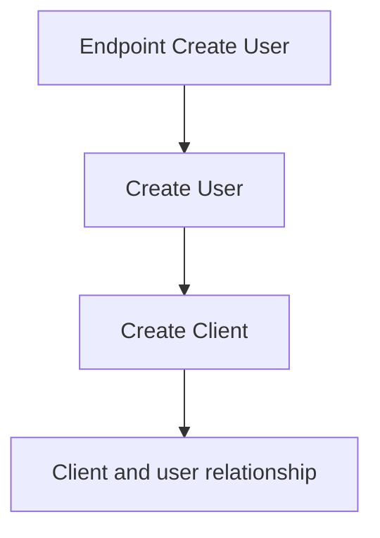
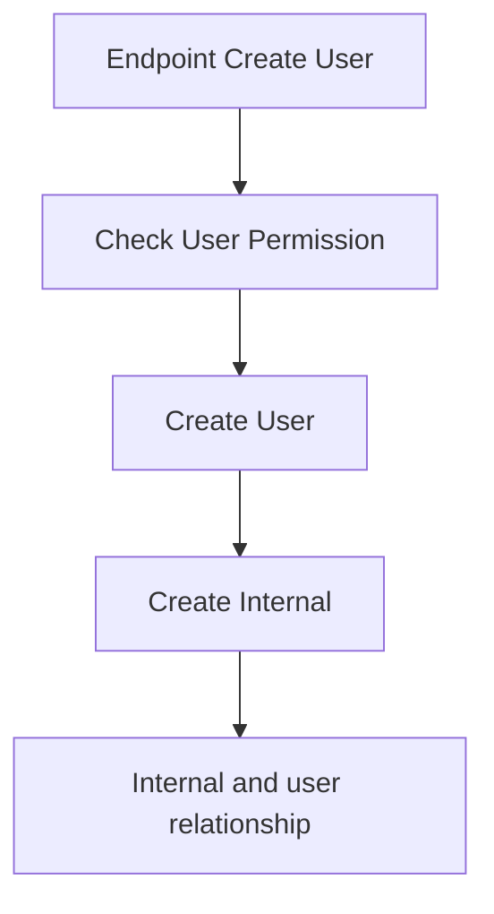

O *User* se trata de uma entidade comum que pode ser relacionado com uma entidade *Client* ou *Internal*. Essas relações definem usuários internos e usuários clientes. Cada um tem regras de negócios diferentes para *CRUD* e operações.

## Client User

O *Client User* representa um cliente que utiliza e consome do serviço fornecido pelo sistema. 

Ao criar uma conta o usuário precisa fornecer os seguintes dados:

- Email
- Password
- Name
- Last Name
- CPF (opcional)
- Endereço (opcional)

O email é único no sistema (sem diferenciar maiúsculas de minúsculas), tanto para *Client User* quanto para *Internal User*. Um *User* é sempre **ou** cliente **ou** interno, nunca os dois.

O cadastro (`POST /users`) é público. Depois de logado, o cliente consulta, edita, desativa e exclui a **própria** conta, além dos próprios dados de cliente e endereços. A conta de outro usuário só é acessível com `manage_users` (ver [[#Acesso à API|Acesso à API]]).

Fluxo para criar um *Client User*:

### User Address

Um usuário opcionalmente pode adicionar um endereço ao criar uma conta. Mas ele se torna obrigatório ao realizar um pedido. As informações necessárias para o *user address* são:

- Street Address
- Number
- CEP
- Complement

---
## Internal User

O *Internal User* representa um usuário com permissões especiais para gerenciamento do sistema e procedimentos. Apenas usuários internos com permissão de `manage_users` podem criar, editar e desativar usuários. Deletar um *Internal User* só pode ser feito por um usuário com a role reservada `super_admin` (ver [[#Bootstrap|Bootstrap]]), após o *Internal User* ser desativado. A regra vale pelos dois caminhos: `DELETE /internal/{id}` e `DELETE /users/{id}`.

Desativar é uma flag `active` no *User* (vale para cliente e interno; todo usuário nasce ativo e pode ser reativado). Deletar um *Internal User* ainda ativo é recusado. Deletar um *Internal User* remove também o *User* associado.

Para criar um *Internal User* é necessário os seguintes dados:

- Email
- Password
- Name
- Last name
- CPF
- Role (opcional — se não for informada, o *Internal* recebe a role padrão; ver [[#Roles|Roles]])
- User permissions (opcional — permissões individuais, somadas às da role; mesmo catálogo de [[#Permissions|Permissions]])

Fluxo para criar um *Internal User*:

### Roles

As *roles* se tratam de um conjunto de permissões que um usuário interno pode ter. Uma role pode ser criada por um usuário que tenha a permissão `manage_roles`. Para criar uma role é necessário as seguintes informações:

- Name (único entre as roles)
- Permissions (lista obrigatória, mas pode ser vazia)
- Default role (opcional, `false` por padrão)

As *permissions* são pré-definidas no sistema (catálogo fixo, ver [[#Permissions|Permissions]]) e cada role guarda a sua lista de permissões — uma role pode ter várias permissões, e uma permissão pode estar em várias roles. Uma role só aceita *permissions* válidas (existentes no catálogo); um valor fora do catálogo é recusado com `400`.

Assim como o *User*, a role tem uma flag `active`: toda role nasce ativa, a edição não altera o valor e ela pode ser desativada/reativada por `POST /internal-roles/{id}/deactivate` e `POST /internal-roles/{id}/activate`.

Existe no máximo uma **role padrão**. Ao criar ou editar uma role com `defaultRole = true`, a role padrão anterior deixa de ser padrão. A role padrão é atribuída ao *Internal* criado sem role; se nenhuma role padrão estiver configurada, essa criação é recusada (`400`).

Uma role atribuída a pelo menos um *Internal User* não pode ser deletada (`400`).

Quem gerencia roles só cria, edita ou reativa uma role com permissões que ele mesmo tem (ver [[#Regras contra escalada de privilégio|Regras contra escalada de privilégio]]).

> Modelo de dados: o catálogo de *permissions* é o enum `InternalPermission` (valores em maiúsculas na API, ex.: `MANAGE_USERS`), sem tabela própria. As permissões de uma role ficam numa coluna array na própria tabela:
>
> - `internal_role(id, name UNIQUE, permissions[], default_role, active, reserved)` — `reserved` marca a role `super_admin`.
> - `internal(id, user_id, internal_role_id, user_permissions[], name, last_name, cpf)` — `user_permissions` são permissões individuais do usuário interno, além das da role.
>
> O diagrama está em `docs/data-modeling/data_modeling.drawio`, na página *User*.

## Permissions

| Permission         | Description                                                                                                                                                                |
| ------------------ | -------------------------------------------------------------------------------------------------------------------------------------------------------------------------- |
| manage_users       | Permissão para gerenciar usuários. Possibilita criar, editar e desativar um usuário                                                                                        |
| manage_roles       | Permissão para gerenciar roles. Possibilita criar, editar e deletar roles                                                                                                  |
| manage_products    | Permissão para gerenciar produtos. Possibilita criar, editar, deletar e alterar o status de produtos. Também permite modificar os ingredientes ao qual um produto depende. |
| manage_ingredients | Permissão para gerenciar os ingredientes cadastrados no sistema. Possibilita cadastrar, editar, deletar e alterar o status de um ingrediente.                              |
| manage_promotions  | Permissão para gerenciar os combos e promotions existentes. Possibilita criar, editar, deletar e alterar o status de um combo/promotion.                                   |
| manage_orders      | Permissão para operar pedidos (ver [[orders]]). Possibilita lançar pedidos no balcão, listar e acompanhar todos os pedidos, avançar status, marcar como pago, editar itens e cancelar. |

## Bootstrap

O primeiro *Internal User* do sistema não pode ser criado pelo fluxo normal, já que esse fluxo exige a permissão `manage_users`, que ninguém ainda possui. Por isso, a cada subida da API, depois das migrations, o `SuperAdminBootstrap` garante:

1. A role reservada `super_admin` (`reserved = true`), com todas as permissões do catálogo. Se ela já existe, as permissões são sincronizadas com o enum: uma permissão nova chega ao `super_admin` sem migration.
2. Um *Internal User* com essa role, criado só se nenhum interno a tiver. O email e a senha vêm das variáveis `NIPPON_BOOTSTRAP_ADMIN_EMAIL` e `NIPPON_BOOTSTRAP_ADMIN_PASSWORD`.

Não existe senha padrão. Sem as variáveis, a API sobe, registra um aviso no log e não cria o usuário. Se o email já pertence a outra conta, ela não é promovida: o log registra um erro e nada é criado.

Proteções da role reservada:

- não pode ser editada, desativada nem deletada (`400`), e por isso também nunca vira role padrão;
- só um `super_admin` cria um interno com ela, troca a role de um interno de ou para ela, ou edita um interno que a tenha (`403`);
- o último `super_admin` ativo não pode ser desativado (`400`).

## Acesso à API

Todo endpoint declara quem pode chamá-lo; um endpoint sem declaração é negado. Sem token válido a resposta é `401`; com token, mas sem a permissão, `403`.

| Recurso | Leitura | Escrita |
| --- | --- | --- |
| `/products/**` (com tamanhos, ingredientes e adicionais) e `/sizes/**` | pública | `manage_products` |
| `/ingredients/**` | pública | `manage_ingredients` |
| `/combos/**`, `/promotions/**`, `/promotion-types/**` | pública | `manage_promotions` |
| `GET /products/{id}/dependents` | `manage_products` | — |
| `GET /ingredients/{id}/dependents` | `manage_ingredients` | — |
| `/internal-roles/**` | `manage_roles` | `manage_roles` |
| `/internal/**` | `manage_users` | `manage_users` |
| `DELETE /internal/{id}` | — | `super_admin` |
| `POST /users` (cadastro de cliente) | — | pública |
| `GET /users` | `manage_users` | — |
| `/users/{id}/**` | o próprio usuário ou `manage_users` | o próprio usuário ou `manage_users` |
| `POST /users/{id}/activate` | — | `manage_users` |
| `GET /auth/me` | autenticado | — |
| `POST /orders/quote` | — | pública |
| `POST /orders` | — | pública (visitante), cliente autenticado ou `manage_orders` |
| `GET /orders` | `manage_orders` | — |
| `GET /orders/events` (SSE) | `manage_orders` | — |
| `GET /orders/{id}` | dono, token de acompanhamento (`X-Order-Token`) ou `manage_orders` | — |
| `GET /orders/{id}/events` (SSE) | dono, token de acompanhamento ou `manage_orders` | — |
| `POST /orders/{id}/cancel` | — | dono ou token (só em `PENDING`), ou `manage_orders` |
| `POST /orders/{id}/feedback` | — | dono ou token |
| `POST /orders/{id}/status`, `POST /orders/{id}/pay`, `PUT /orders/{id}/items` | — | `manage_orders` |
| `GET /users/{id}/orders` | o próprio usuário ou `manage_users` | — |

`POST /auth/login`, `/auth/refresh` e `/auth/logout` são públicas. O Swagger (`/api`) e o schema (`/q/openapi`) também.

"O próprio usuário ou `manage_users`" depende do `{id}` da rota e é conferido no `UserService`, antes de buscar o usuário: um id inexistente também devolve `403` para quem não pode acessá-lo, sem revelar se a conta existe.

## Regras contra escalada de privilégio

Ninguém concede o que não tem; o `super_admin` é a única exceção. As regras vivem nos Services e devolvem `403`, exceto onde indicado.

| Regra | Onde |
| --- | --- |
| As `user_permissions` concedidas a um interno precisam estar entre as permissões de quem concede. Na edição, só as permissões **adicionadas** são conferidas. | `InternalService` |
| Atribuir uma role exige ter todas as permissões dela. Na edição, só quando a role muda. | `InternalService` |
| Criar, editar ou reativar uma role exige ter todas as permissões dela. | `InternalRoleService` |
| Ninguém altera a própria role nem as próprias `user_permissions`, nem o `super_admin`. | `InternalService` |
| Só um `super_admin` edita, ativa, desativa ou deleta um `super_admin`. Sem essa regra, quem tem `manage_users` trocaria a senha do `super_admin` e entraria como ele. | `UserService` |
| O último `super_admin` ativo não pode ser desativado (`400`). | `UserService` |

---
## Guest User

Representa um usuário que não possui um cadastro, ou seja, não é um *Client User*. Esse usuário permite que um consumidor possa utilizar dos serviços, sem a necessidade de passar pelo fluxo de cadastro/login. Utilizar o sistema desta forma limita a experiência do usuário, pois inúmeras funcionalidades ficam indisponíveis. Funcionalidades como:

- Acúmulo de pontos;
- Utilização de pontos;
- Preenchimento automático de dados necessário ao fazer um pedido;
- Salvar endereços;
- Salvar formas de pagamento.
- Histórico de pedidos

Nenhum dado desse tipo de usuário fica persistido. Apenas o necessário para a realização de análises de negócio. Os dados de entrega que ele informa (nome, telefone e endereço) ficam gravados só no próprio pedido, e ele acompanha o pedido por um token de acompanhamento devolvido na criação (ver [[orders#Acompanhamento do visitante|Acompanhamento do visitante]]). Exemplos de casos onde dados de Guest User podem ser salvos:

- Histórico de pedidos geral;
- Analytics (mediante aceite do usuário).